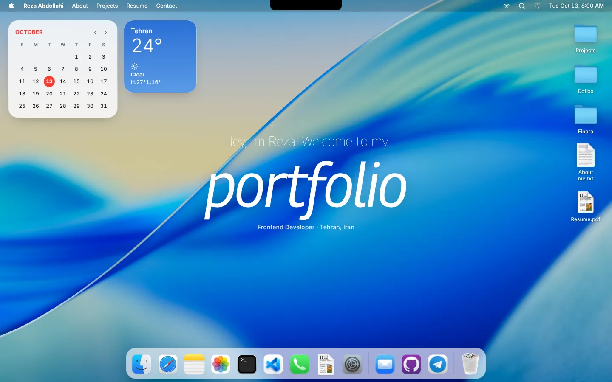
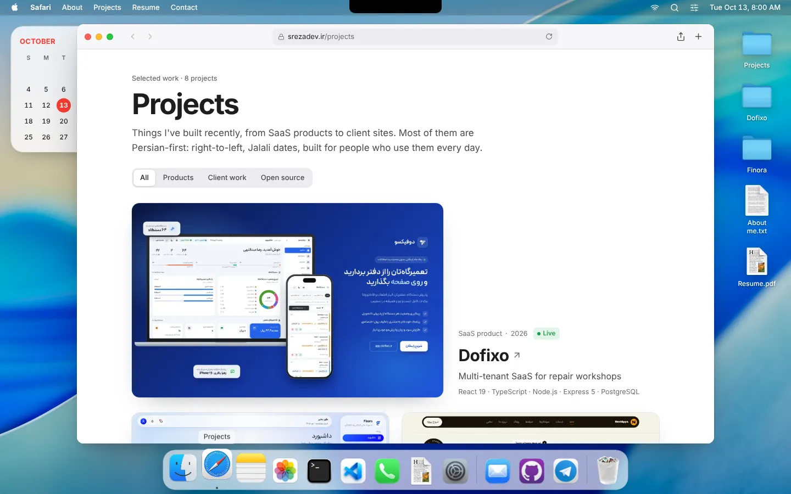
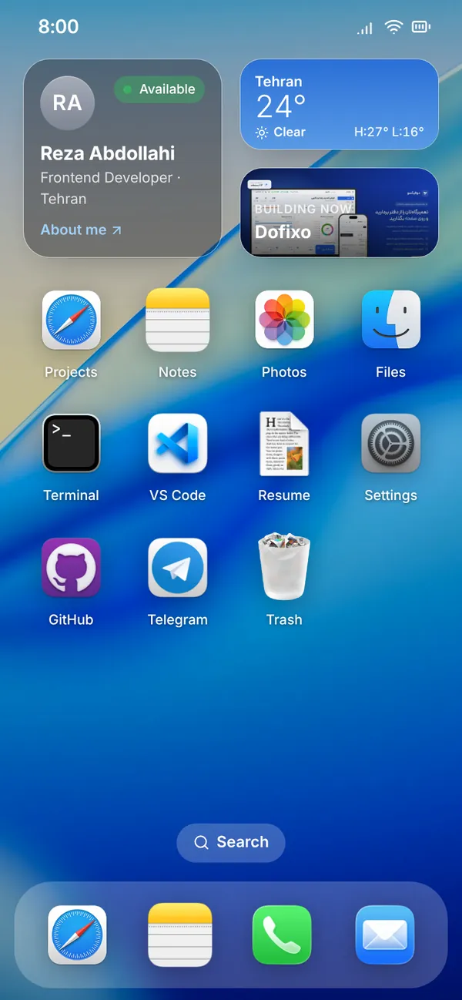

<div align="center">

# macOS Portfolio

### Reza Abdollahi's portfolio, built as a desktop you can explore

[](https://react.dev/)
[](https://vitejs.dev/)
[](https://tailwindcss.com/)
[](https://gsap.com/)
[](https://zustand-demo.pmnd.rs/)

[Live site](https://srezadev.ir) · [نسخه فارسی](https://srezadev.ir/fa/) · [Resume (PDF)](https://srezadev.ir/files/reza-abdollahi-resume.pdf)



</div>

## About

Instead of a scrolling page, this portfolio is an operating system. On a laptop
you get a macOS desktop with a menu bar, a dock and draggable windows. On a phone
the same apps open from an iOS-style home screen as full-screen sheets.

Every app shows a different side of my work, and every piece of content comes
from one set of data files, so projects, notes, the terminal, Spotlight and the
resume never drift apart. The whole site also exists in Persian, right-to-left
with the Jalali calendar, at [`/fa/`](https://srezadev.ir/fa/).

## Apps

| App | What it does |
| --- | --- |
| **Projects** (Safari) | Case studies for each project with tabs, back/forward history, filters, screenshots and a lightbox. Pages are deep-linkable: `srezadev.ir/#/projects/dofixo` |
| **Notes** | The "about me", what I'm building, my stack and the site roadmap, in an Apple Notes layout with search |
| **Terminal** | A zsh-like shell over a virtual filesystem built from the site's data: `ls -la`, `cd dofixo`, `cat README.md`, `tree`, `find`, `grep -rn`, `open .`, pipes, `&&`, `>` redirects, globs, Tab completion, history and `neofetch` |
| **Finder** | Every project as a folder with its write-up, links and screenshots. Old experiments live in the Trash |
| **Photos** | Albums of screenshots, one per project |
| **VS Code** | The site's own data as code, with a small syntax highlighter, file search and source control panel |
| **Mail** | A compose window that sends a message straight to my inbox, with validation, a saved draft and spam protection |
| **Contacts** | Email (with copy), phone, Telegram, GitHub, LinkedIn and Tehran local time |
| **Resume** | An HTML resume with print styles and a PDF download |
| **System Settings** | Appearance (light, dark, auto), language (English or Persian) and four wallpapers, saved per visitor |

Plus **Spotlight** (<kbd>⌘K</kbd> / <kbd>Ctrl K</kbd>) across apps, projects,
notes and actions in both languages, a **Control Center** with dark mode,
language, brightness, volume and a music player, and three desktop widgets: a
calendar (Gregorian or Jalali), live **Tehran weather** and live **GitHub
activity** (the contribution graph and my latest commits).

### Feels like a Mac

| | |
| --- | --- |
| **Mission Control** | <kbd>F3</kbd> or <kbd>⌃↑</kbd> spreads every open window out side by side; click one to bring it forward |
| **Tiling** | Drag a window to the left or right edge to fill that half, or into the menu bar to fill the screen. Drag it away to get its old size back |
| **Resizing** | Drag any edge or corner |
| **Right-click** | The desktop has its own context menu: new message, new terminal, Mission Control, show desktop, wallpaper, dark mode, language |
| **Shortcuts** | <kbd>⌥W</kbd> close, <kbd>⌥M</kbd> minimise, <kbd>⌥Z</kbd> zoom, <kbd>⌥`</kbd> next window, <kbd>⌥D</kbd> show desktop, <kbd>⌥L</kbd> language, <kbd>?</kbd> lists them all |
| **On a phone** | Pull down on the home screen to search; the back gesture closes whatever is on top |

<p align="center">
  
  &nbsp;
  
</p>

## Featured projects

| Project | What it is |
| --- | --- |
| [Dofixo](https://dofixo.ir) | Multi-tenant SaaS for repair workshops: React 19, Node.js, PostgreSQL with row-level security, Prisma |
| [Finora](https://github.com/Rezaabdollahi7/Finora) | Self-hosted, Persian-first household finance manager: Next.js, Prisma, PostgreSQL, Three.js |
| [NextApps](https://nextapps.ir) | The digital product studio I founded: Next.js, TypeScript |
| [SieManage](https://siemanage.com) | Real-time task management for teams: React, Express, PostgreSQL, Socket.io |
| [Siemenspart](https://github.com/Rezaabdollahi7/siemenspart-landing) | Catalogue site for industrial CNC parts: Astro, React, Fuse.js |
| [DashStack](https://github.com/Rezaabdollahi7/DashStack) | Open-source admin dashboard template: React, Material UI, Tailwind CSS 4 |
| [Maliko](https://github.com/Rezaabdollahi7/maliko-landing) | Landing page for an SMS-powered finance app: Next.js, GSAP, Lottie |

## How it works

- **Window manager.** `src/store/window.js` keeps each window's open, minimised,
  zoomed and tiled state plus a stacking order. `src/hoc/WindowWrapper.jsx` turns
  any component into a window: drag by the title bar (GSAP Draggable, kept on
  screen), tile to an edge, resize from any side (`src/lib/windowGeometry.js`),
  double-click to zoom (GSAP Flip), minimise to the dock, animated open and
  close, and a full-screen sheet on phones. Mission Control
  (`src/components/MissionControl.jsx`) animates the real windows into a grid
  and back.
- **Two languages.** `src/i18n/` holds the interface strings (`ui.js`), the
  locale store and helpers. English content is the source; Persian overrides
  (`profileFa`, `notesFa`, `projects.fa.js`) are merged on top field by field.
  Persian switches the page to `dir="rtl"` (layouts use CSS logical properties),
  dates to the Jalali calendar via `Intl` (`fa-IR-u-ca-persian`), digits to
  Persian, and fonts to Rokh (headings) and Dana (text). `/fa/` is its own HTML
  entry with Persian meta tags and `hreflang` links for search engines. Code,
  the terminal and the resume stay left-to-right.
- **Code splitting.** Each app is a lazy chunk that loads the first time it opens
  or when you hover its dock icon. The shell (React, GSAP, the desktop and both
  languages) is about 160 KB of gzipped JS, down from 270 KB before the redesign.
- **Back button on phones.** `src/lib/backStack.js` keeps one guard history
  entry while anything is open, so the browser or system back gesture closes
  the top layer (image viewer, Spotlight, an in-app page, then the app) instead
  of leaving the site. With nothing open, back leaves as usual.
- **One content source.** `src/constants/` holds the profile, projects, notes,
  Finder tree and editor files. Everything else reads from there.
- **Responsive by container.** Windows use container queries, so layouts adapt to
  the window's size, whether it's zoomed, dragged small or on a phone.
- **Accessible.** Real buttons and links, visible focus rings, labelled controls,
  `prefers-reduced-motion` support, a skip link, and a `<noscript>` fallback.
- **Fast in Iran.** Fonts (Geist, Geist Mono, Georama, Dana, Rokh) are
  self-hosted, so there are no Google Fonts requests. Music only downloads when
  you press play.
- **Live data, gracefully.** Weather (Open-Meteo) and GitHub activity
  (`src/lib/github.js`: the contributions calendar API, commit search, and push
  events as a fallback) are fetched in the browser with no keys, cached in
  storage, and fall back to cached or placeholder data when offline.

## Project structure

```
src/
├── App.jsx                 # Desktop or phone shell + windows
├── i18n/                   # strings, locale store, Persian content merge
├── constants/              # profile, projects (+ projects.fa.js), notes, apps, finder, vscode
├── store/                  # window manager, settings (persisted), UI, music
├── hoc/WindowWrapper.jsx   # drag, focus, minimise, zoom, animations
├── hooks/                  # media queries, theme, weather, GitHub, deep links, shortcuts
├── lib/                    # actions, window geometry, calendar, contact form, GitHub, terminal
├── components/
│   ├── menubar/            # menu bar, Apple menu, Control Center
│   ├── desktop/            # welcome, widgets (calendar, weather, GitHub), icons, context menu
│   ├── mobile/             # iOS home screen
│   ├── safari/             # projects index, cards, case study page
│   ├── window/             # header, traffic lights, context
│   ├── Dock.jsx · Spotlight.jsx · MissionControl.jsx · KeyboardShortcuts.jsx
│   ├── Lightbox.jsx · ResumeDocument.jsx
└── windows/                # one file per app, lazy-loaded from index.js
```

## Getting started

```bash
pnpm install
pnpm dev        # http://localhost:5173
pnpm build && pnpm preview
pnpm lint
```

### Contact form

The Mail app posts JSON to any form service. Set the endpoint at build time
(for example in Vercel's environment variables):

```bash
# Formspree: create a form at formspree.io and use its endpoint
VITE_CONTACT_ENDPOINT=https://formspree.io/f/yourFormId

# or Web3Forms: endpoint plus the access key it emails you
VITE_CONTACT_ENDPOINT=https://api.web3forms.com/submit
VITE_CONTACT_ACCESS_KEY=your-access-key
```

Without an endpoint the form still works: it opens the visitor's email app
with the message filled in.

### Editing content

- Projects: `src/constants/projects.js` (screenshots go in `public/images/projects/<Name>/`),
  Persian text in `src/constants/projects.fa.js`
- About, notes and roadmap: `src/constants/notes.js` and `src/constants/profile.js`
  (each has a Persian version next to the English one)
- Interface strings in both languages: `src/i18n/ui.js`
- Resume: built from the same data in `src/components/ResumeDocument.jsx`. After
  editing, regenerate `public/files/reza-abdollahi-resume.pdf` by printing the
  Resume window to PDF (A4).

### Fonts

Dana and Rokh (the Persian fonts in `public/fonts/`) are commercial typefaces.
This repository is public, so keep their files here only if your license
allows self-hosting them in a public repo.
